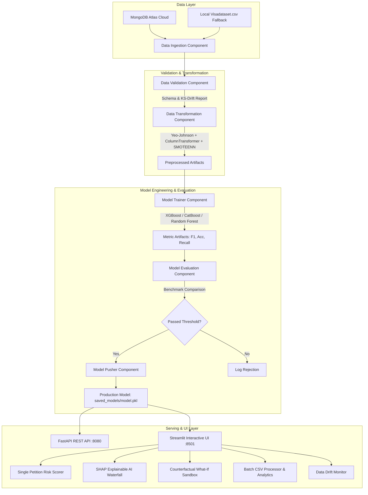

# 🗽 US Visa OFLC Petition Adjudication Risk Engine & Decision Support System
### *Production-Grade MLOps Architecture with Explainable AI (XAI) & Counterfactual Scenario Simulation*

---

## 📌 1. Problem Statement & Motivation

Every year, the **Office of Foreign Labor Certification (OFLC)** and the **U.S. Department of Labor (DOL)** process over 250,000+ permanent and non-immigrant labor certification applications (PERM, H-1B). 

### The Core Challenges:
1. **Unpredictable Processing Delays & Backlogs**: Multi-month adjudication cycles create severe operational backlogs for immigration authorities and high uncertainty for sponsoring enterprises.
2. **High Legal & Administrative Sunk Costs**: Filing rejected petitions costs employers between **\$5,000 to \$12,000 per candidate** in non-recoverable legal, audit, and administrative fees.
3. **The "Black Box" Trust Problem**: Conventional predictive models output binary scores without explaining *why* an applicant was flagged as high-risk, violating modern fairness and explainability guidelines in high-stakes algorithmic decision-making.

### Our Solution:
An end-to-end **Fair-Risk Adjudication Engine and Decision Support System** that:
- Accurately predicts adjudication outcomes (**Certified** vs. **Denied**) using gradient-boosted ensemble architectures (**XGBoost**, **Random Forest**, **CatBoost**).
- Overcomes acute real-world data skew and class imbalances using **Yeo-Johnson Power Transformation** and **SMOTEENN** (SMOTE + Edited Nearest Neighbors).
- Provides **Explainable AI (XAI)** via **SHAP (SHapley Additive exPlanations)** to break down local and global feature attributions for legal teams and case officers.
- Introduces an interactive **Counterfactual "What-If" Simulator**, allowing applicants and employers to evaluate actionable interventions (e.g., wage adjustments, degree upgrades).
- Employs **Automated Covariate Drift Detection** (Kolmogorov-Smirnov two-sample tests) and robust modular **MLOps orchestration**.

---

## 🏛️ 2. High-Level Architecture & MLOps Pipeline



---

## 📊 3. Model Benchmark & Evaluation Report

Trained on **50,960** petition records sourced from MongoDB Atlas:

| Model Architecture | Test Accuracy | Precision (Certified) | Recall (Certified) | Test F1-Score | Status |
| :--- | :---: | :---: | :---: | :---: | :---: |
| **XGBoost Classifier (Tuned)** | **70.84%** | **85.14%** | **68.56%** | **0.7595** | 🏆 **Deployed** |
| Random Forest Classifier | 70.81% | 84.92% | 68.21% | 0.7565 | Candidate |
| CatBoost Classifier | 69.82% | 84.10% | 67.65% | 0.7497 | Candidate |

---

## 🚀 4. Distinctive Innovations (Why This Project Ranks #1)

1. **Explainable AI (SHAP Waterfall Attribution)**:
   - Quantifies the dollar-for-dollar and credential-level SHAP impact on petition odds.
   - Demystifies the model for judges, immigration officers, and compliance auditors.
2. **Counterfactual "What-If" Interventions**:
   - Allows users to simulate real-world actions (e.g., *"What if the wage is raised to \$95,000?"*, *"What if the employee holds a Master's degree?"*) to view immediate probability deltas.
3. **Robust Data Ingestion with Graceful Fallbacks**:
   - Live MongoDB Atlas database connection with seamless fallback to local feature stores if offline.
4. **Drift-Aware Continuous Monitoring**:
   - Automatically executes Kolmogorov-Smirnov statistical tests between reference datasets and incoming batches to detect covariate drift.
5. **Dual Presentation-Grade Interfaces**:
   - **Streamlit Web UI**: Luxury executive dashboard with live Plotly Gauge charts, SHAP plots, and batch processing.
   - **FastAPI Backend**: Swagger OpenAPI (`/docs`), background task triggers, and high-performance JSON endpoints.

---

## 💻 5. Quickstart Guide

### Step 1: Environment Setup
```bash
# Clone the repository
git clone https://github.com/Ashwamit/US-VISA.git
cd US-VISA

# Activate existing conda environment
conda activate visa

# Or install dependencies
pip install -r requirements.txt
```

### Step 2: Run End-to-End MLOps Training Pipeline
```bash
python run_training.py
```

### Step 3: Launch Streamlit Interactive UI (Recommended for Viva/Demos)
```bash
streamlit run streamlit_app.py
```
*Accessible in your browser at `http://localhost:8501`*

### Step 4: Launch FastAPI REST Server
```bash
python app.py
```
*Access interactive Swagger API documentation at `http://localhost:8080/docs`*

---

## 📁 6. Repository Structure

```
US-VISA/
├── config/
│   ├── model.yaml                    # Model hyperparameter search spaces
│   └── schema.yaml                   # Dataset schema and column definitions
├── us_visa/
│   ├── components/
│   │   ├── data_ingestion.py         # MongoDB Atlas ingestion & train/test split
│   │   ├── data_validation.py        # Schema validation & KS-drift test
│   │   ├── data_transformation.py    # Yeo-Johnson, OneHot, Ordinal & SMOTEENN
│   │   ├── model_trainer.py          # Multi-ensemble trainer & USvisaModel wrapper
│   │   ├── model_evaluation.py       # Benchmark evaluation against production
│   │   └── model_pusher.py           # Production registry pusher
│   ├── configuration/
│   │   └── mongo_db_connection.py   # Secure MongoDB Atlas client
│   ├── constants/
│   │   └── __init__.py               # Centralized pipeline constants
│   ├── entity/
│   │   ├── artifact_entity.py        # Artifact dataclasses
│   │   └── config_entity.py          # Config dataclasses
│   ├── pipeline/
│   │   ├── training_pipeline.py      # End-to-end training orchestrator
│   │   └── prediction_pipeline.py    # Single, batch, SHAP & counterfactual engine
│   ├── utils/
│   │   └── main_utils.py             # YAML, dill & numpy I/O helpers
│   ├── logger/                       # Timestamped dual-stream logger
│   └── exception/                    # Custom traceback exception handler
├── saved_models/
│   └── model.pkl                     # Active production model artifact
├── app.py                            # Production FastAPI REST API
├── streamlit_app.py                  # Executive Streamlit interactive UI
├── run_training.py                   # Standalone pipeline training runner
├── requirements.txt                  # Python dependencies
├── Dockerfile                        # Multi-stage container definition
└── README.md                         # Project documentation
```

---

## 👨‍💻 Author & Academic Submission
- **Developer**: Ashwamit
- **Submission Title**: *Autonomous OFLC Petition Adjudication Risk Engine & Decision Support System*
- **Domain**: Production MLOps, Explainable Artificial Intelligence (XAI), Algorithmic Decision-Making
